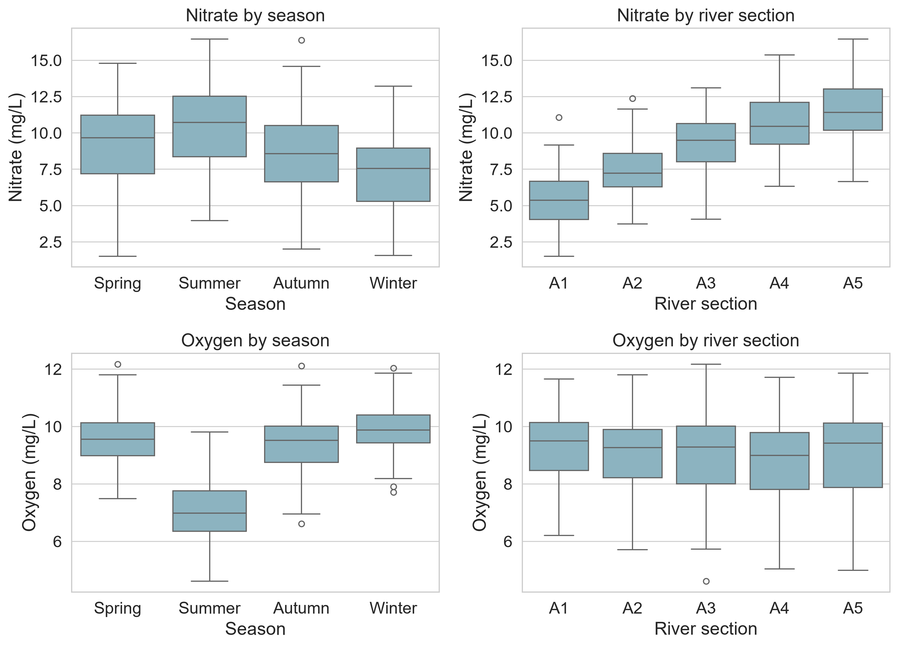
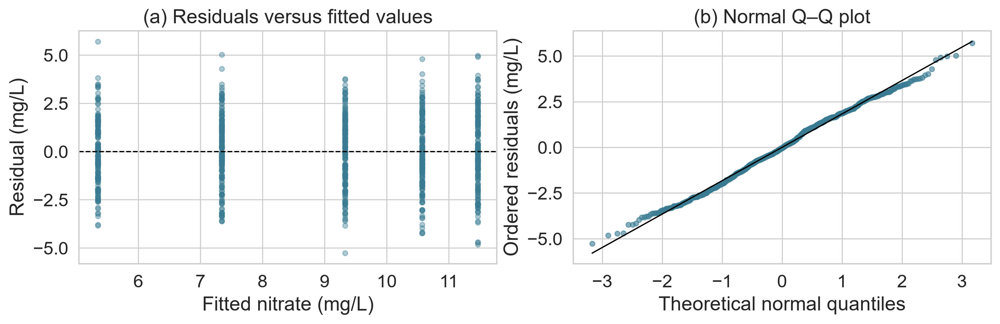

# River Water Quality Analysis

Comparison of nitrate and oxygen concentrations across seasons and five river sections, from headwaters to mouth.

The analysis answers two questions:

1. Do spring and autumn differ in nitrate and oxygen concentrations?
2. Do concentrations differ between river sections, and which sections differ?

## Dataset

`waterquality.csv` contains 900 measurements and five columns:

| Column | Description |
| --- | --- |
| `ID` | Measurement identifier |
| `river_section` | Five ordered sections, A1 headwaters to A5 mouth |
| `saison` | Spring, summer, autumn or winter |
| `nitrate_mgL` | Nitrate concentration in mg/L |
| `oxygen_mgL` | Oxygen concentration in mg/L |

Each section contains 180 measurements: 45 per season. There are no missing values or duplicate IDs. All observations are retained. The data do not contain sampling dates or repeated-site identifiers; independence is assumed and cannot be verified from these columns. The two concentrations in a row are different outcomes, not independent replicates of the same outcome.

## Methods

The script and notebook follow the same sequence:

1. Load the data and check counts, missing values and identifiers.
2. Calculate count, mean, sample standard deviation, minimum, Q1, median, Q3 and maximum overall, by season and by section. Calculate section × season means.
3. Create a four-panel boxplot. Whiskers extend to observations within 1.5 interquartile ranges; points outside them remain in the analysis.
4. Check normality with Shapiro–Wilk and variance homogeneity with the median-centred Levene test (Brown–Forsythe variant), using 0.05 for diagnostic checks.
5. Compare spring and autumn using two-sided Welch tests, mean-difference confidence intervals and Cohen's d.
6. Compare nitrate across sections using one-way ANOVA, eta squared and Tukey HSD.
7. Compare oxygen across sections using Kruskal–Wallis and Dunn tests with Holm correction across the ten section pairs.
8. Fit a complementary two-way ANOVA (section × season, type II sums of squares) for both concentrations, with partial eta squared and residual checks. For oxygen, test the section effect within each season using the two-way error term and Bonferroni α = 0.05/4.
9. Inspect the nitrate ANOVA residuals using a residuals-versus-fitted plot and a normal Q–Q plot, alongside the group-wise Shapiro–Wilk and Levene checks.

RQ1 uses only the 450 spring and autumn observations. Bonferroni correction gives a threshold of 0.025 for each of its two primary Welch tests. Mean differences and Cohen's d use spring minus autumn. Cohen's d divides this difference by the pooled sample standard deviation. The 95% confidence intervals describe individual mean differences; they are not simultaneous Bonferroni intervals or intervals for d.

RQ2 uses all 900 observations. Its two outcome-specific analyses use 0.05, with Tukey or Holm controlling comparisons within each outcome; no study-wide error-rate control is claimed. Tukey differences use group 2 minus group 1, with simultaneous 95% intervals. Eta squared is between-section sum of squares divided by total sum of squares.

Nitrate is not normally distributed within the two RQ1 seasons according to Shapiro–Wilk (p = 0.0206 and 0.0179). Welch remains a reasonable large-sample mean comparison with 225 observations per group. For nitrate across sections, Shapiro–Wilk p-values exceed 0.05 and Levene p = 0.3566; these checks do not establish independence or prove normality.

Oxygen across sections departs from normality and has unequal variances (Levene p = 0.0128). Kruskal–Wallis and Dunn compare rank distributions. With differing distribution shapes and spreads, their results should not be described solely as differences in means or medians. See the [SciPy Kruskal–Wallis documentation](https://docs.scipy.org/doc/scipy/reference/generated/scipy.stats.kruskal.html) and [Dunn test documentation](https://scikit-posthocs.readthedocs.io/en/latest/generated/scikit_posthocs.posthoc_dunn.html) for implementation details.

The one-way tests answer the research questions as posed, comparing seasons and sections averaged over the other factor. The two-way ANOVA models both factors jointly; it tests whether section differences depend on the season and whether the one-way oxygen non-normality results from pooling the seasons.

## Results

### Descriptive analysis

Mean nitrate rises from 5.350 mg/L at A1 to 11.467 mg/L at A5. Mean oxygen ranges from 8.694 mg/L at A4 to 9.231 mg/L at A1. Summer has the highest mean nitrate (10.342 mg/L) and lowest mean oxygen (7.040 mg/L).



### Spring versus autumn

| Outcome | Spring mean | Autumn mean | Difference (95% CI), mg/L | Cohen's d | Welch p | Bonferroni p |
| --- | ---: | ---: | --- | ---: | ---: | ---: |
| Nitrate | 9.289 | 8.418 | 0.871 (0.375, 1.366) | 0.326 | 0.0006 | 0.0012 |
| Oxygen | 9.531 | 9.379 | 0.152 (-0.010, 0.314) | 0.174 | 0.0654 | 0.1308 |

Nitrate is higher in spring. The oxygen comparison does not provide sufficient evidence of a spring–autumn difference; this does not establish equality.

### River sections

Nitrate: F(4, 895) = 329.104, p < 0.001, eta squared = 0.595. All ten section pairs differ under Tukey HSD. All adjusted p-values are below 0.001; very small computed values should be reported as inequalities rather than treated as precise tail probabilities.

Oxygen: H(4) = 11.645, p = 0.0202. Only A1 headwaters versus A4 lower course is significant after Dunn–Holm correction (adjusted p = 0.0079). A1 has higher observed mean and median oxygen. The other nine comparisons do not provide sufficient evidence of distribution differences after adjustment.

### Two-way ANOVA

| Outcome | Effect | df | F | p | Partial eta squared |
| --- | --- | ---: | ---: | ---: | ---: |
| Nitrate | Section | 4 | 544.834 | < 0.001 | 0.712 |
| Nitrate | Season | 3 | 197.138 | < 0.001 | 0.402 |
| Nitrate | Section × season | 12 | 0.856 | 0.5928 | 0.012 |
| Oxygen | Section | 4 | 9.519 | < 0.001 | 0.041 |
| Oxygen | Season | 3 | 554.258 | < 0.001 | 0.654 |
| Oxygen | Section × season | 12 | 3.897 | < 0.001 | 0.050 |

All effects use 880 error degrees of freedom. Two-way residuals show no evidence against normality (Shapiro–Wilk p = 0.8499 for nitrate and 0.9433 for oxygen) or equal variances across the 20 section × season cells (Levene p = 0.8005 and 0.4459).

Oxygen section effect within each season (Bonferroni α = 0.0125): summer F(4, 880) = 14.74, p < 0.001; autumn 3.44, p = 0.0085; spring 1.45, p = 0.2140; winter 1.58, p = 0.1770. Oxygen differs between sections in summer and autumn but not in spring or winter.

### Nitrate ANOVA model checks

For the one-way nitrate model, fitted values are section means and residuals are observed concentrations minus those means. The residuals-versus-fitted plot shows the spread around each section mean; five vertical bands arise because there are five sections. The normal Q–Q plot compares ordered residuals with theoretical normal quantiles. Its reference line is fitted to the residuals, so residuals in mg/L need not follow a unit-slope line.



These graphical checks complement the section-wise normality and variance checks. They cannot establish that observations are independent.

## Limitations and further analysis

Seasonal comparisons average over equally represented sections; section comparisons average over equally represented seasons. Sampling dependence and unmeasured environmental factors could affect inference, and these comparisons do not establish causes.

Low summer oxygen values widen the spread within each section; in the two-way model, the oxygen residuals are normal with equal cell variances, so pooling the seasons explains the one-way departures. Further analysis could use within-season pairwise comparisons to locate the summer and autumn oxygen differences.

## Repository structure

```text
water-quality-analysis.py       Python analysis
water-quality-analysis.ipynb    Notebook with executed outputs
waterquality.csv               Data
fig1_boxplots.png               Four-panel boxplot
fig2_nitrate_anova_diagnostics.png Nitrate ANOVA residual plot and normal Q–Q plot
results/                       Descriptive tables and test results (CSV)
requirements.txt               Package versions
README.md                      Project overview and results
```

The general script/notebook/data/figure layout follows [rider-stage-performance](https://github.com/tallal02/rider-stage-performance). The analysis implements the water-quality comparisons independently.

## Run the analysis

Use Python 3.13 and run the script or notebook with the project folder as the working directory. The code uses direct file paths, separate plotting commands and ordinary loops for the two concentrations and five sections. From this directory:

```bash
python -m venv .venv
```

On Windows PowerShell:

```powershell
.\.venv\Scripts\Activate.ps1
```

Then install packages and run:

```bash
python -m pip install -r requirements.txt
python water-quality-analysis.py
```

The script prints results and saves the figure and CSV tables. To use the notebook, run `jupyter notebook water-quality-analysis.ipynb` and select Run All. Both versions perform the same calculations. CSV files retain numerical precision; displayed summaries above are rounded.
